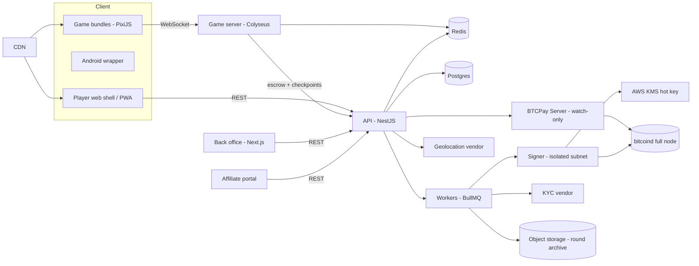

# Project Reef: Fish Arcade Gaming Platform Spec

| | |
|---|---|
| Working name | Project Reef (swap for final brand) |
| Version | 0.2 draft (Bitcoin payments and payouts, see section 22) |
| Date | 2026-11-20 |
| Reference product | Fire Kirin (fish table sweepstakes platform) |
| Status | Draft. Section 4 and section 21 need a lawyer before build past Phase 1 |

---

## 1. Summary

Reef is a browser-first (H5) arcade gaming platform built around multiplayer fish shooting tables, plus slots and keno, with a lobby, a wallet, promotions, and an operator back office.

It matches the Fire Kirin player experience: shared-screen fish tables, bet-level cannons, auto-fire and target lock, special weapons, boss targets, progressive jackpots, and play on phone or desktop browser.

It does not copy Fire Kirin's money layer. Fire Kirin runs on agents who take Cash App, Zelle, Venmo, or crypto off-platform, load credits by hand in a backend, and pay winners by hand. That model is what regulators prosecute, and running it makes you the operator of an unlicensed gambling business. Reef replaces it with an on-platform dual-currency wallet, Bitcoin purchases and payouts handled by the platform's own infrastructure (section 22), a free alternate method of entry (AMOE), KYC, geofencing, and an audit trail.

All game art, names, characters, and audio are original. Nothing from the Fire Kirin brand ships.

---

## 2. Reference platform research

### 2.1 What Fire Kirin is

- Started as sweepstakes software sold to internet cafes and gaming rooms, where staff ran player accounts in person. It later moved online.
- Core content is fish arcade games: animated sea creatures cross a shared screen, players fire at them, each creature carries a multiplier. The catalog also includes slots and arcade titles. Third-party writeups put the app at roughly 40+ games.
- Access is an Android APK (sideloaded, not from Play) plus H5 browser portals. iPhone users play in the browser. The commonly cited web portal (firekirin.xyz) drew about 1.8M visits in August 2025.

### 2.2 How the money and accounts work

- Players do not self-register. An agent or distributor creates the account and hands over a username and password.
- There is no deposit button. The player sends money to the agent through Cash App, Zelle, Venmo, or crypto, and the agent loads credits in the backend.
- Cash-out runs in reverse: the player messages the agent (often over WhatsApp or similar), the agent checks the balance and sends money back.
- There is no central operator handling payouts. Reliability depends on the individual host. Published tests and player reports include agents who took deposits and never paid out.

### 2.3 Backend (agent panel)

- Separate admin URL, only given out by an "upline" operator or distributor. No self-registration.
- Agents create and manage player accounts, add or deduct credits, view reports, and manage sub-agents beneath them.
- Different distributor backends are identified by port numbers (8580, 8680, 8880 are commonly cited).

### 2.4 Game mechanics observed

- Shot level sets the credit cost of each shot.
- Special weapons cost a multiple of the current bet (one published example: a torpedo at 6x).
- Auto-fire and target lock change how shots repeat and track, but do not change odds.
- Hit, capture, and credited award are separate events. Outcomes are decided on the server.
- Weapon and target types seen across titles: laser beams that cut through lines of fish, explosive rockets that clear groups, chain-reaction targets, and one signature boss creature per game that pays a large multiplier.

### 2.5 Legal status

- Not licensed by any gaming commission.
- Michigan's Gaming Control Board sent cease-and-desist letters in March 2025, including one to a fish game app (Orion Stars).
- Fish games appear on restricted lists in several states (Idaho, Washington, Michigan, Montana, Connecticut, New Jersey, Louisiana are commonly cited).
- 2026 brought a wave of state laws aimed specifically at dual-currency sweepstakes models. See section 4.3.

### 2.6 About play.firekiren.com

The site blocks automated access, so its contents were not reviewed. The domain misspells the brand ("kiren" instead of "kirin"), which matches the pattern of lookalike sites that reuse branding to push a different APK or take deposits. Do not use it as a technical reference and do not install anything from it.

---

## 3. Keep vs. change

| Area | Fire Kirin | Reef |
|---|---|---|
| Game experience | Multiplayer fish tables, slots, arcade | Same genre, original art, names, audio |
| Platforms | Sideloaded APK + H5 portals | H5/PWA primary, Android wrapper, iOS via web |
| Account creation | Agent issues credentials | Self-serve signup with OTP, age and location gate |
| Buying credits | Pay an agent off-platform | Buy Gold Coin packages with Bitcoin through platform-issued invoices, Sweeps Coins included free |
| Free entry | Not a real path | AMOE by mail plus daily online free entry |
| Cash out | Message agent, agent pays | In-app redemption request, KYC, Bitcoin payout from the platform wallet to a verified address |
| Back office | Agents add/deduct credits at will | RBAC, reason codes, dual approval, nobody sells credits |
| Distribution | Multi-tier agent network | Affiliate program, max 2 tiers, no custody of player funds |
| Math | Opaque, adjustable "pool" | Fixed RTP per certified config, disclosed, lab tested |
| Oversight | None | Geofence, KYC/AML, responsible gaming tools, audit logs, official rules |

---

## 4. Legal model and launch gating

**This section is a starting point for counsel, not legal advice.** Nothing redeemable goes live until a lawyer signs off on the launch states.

### 4.1 Operating modes (set per state)

| Mode | What's on | Notes |
|---|---|---|
| S (Social) | Gold Coins only, nothing redeemable | Lowest risk. App store rules still apply |
| P (Promotional sweepstakes) | Gold Coins + Sweeps Coins redeemable for cash prizes | Requires AMOE, official rules, KYC, geofence |
| X (Blocked) | Nothing | Signup and play refused |

Config table: `jurisdictions(state_code, mode, min_age, sc_redemption_enabled, fish_games_enabled, effective_from, legal_memo_ref)`. Only the Compliance role can change it. Every change is audited and takes effect at a scheduled time, not instantly mid-session.

### 4.2 Rules that hold the model together

1. No purchase necessary. AMOE gives Sweeps Coins on terms comparable to the purchase path.
2. Sweeps Coins are never sold. Purchases buy Gold Coins. SC comes as a free bonus.
3. Official rules are published, versioned, and accepted at signup. Re-acceptance on any material change.
4. Do not market the games as skill-based. Reef's math is chance by design (section 7), and a "skill" label does not establish lawful status anyway.
5. Expect vendors to be targeted too. States are now going after processors, KYC vendors, affiliates, and suppliers that support sweepstakes casinos. Vendor exits are a real operating risk.
6. Federal exposure: operating an illegal gambling business is a federal crime (18 U.S.C. 1955) wherever state law makes the activity illegal.

### 4.3 Starting state list (counsel must confirm, list changes monthly)

**Likely Mode X (specific bans or existing-law positions reported in 2025 to 2026):**

| State | Basis reported |
|---|---|
| California | AB 831, effective Jan 1, 2026, also covers support activities |
| New York | S5935A signed Dec 2025 |
| New Jersey | Statute treats paid sweepstakes entry as unlawful gambling |
| Maine | LD 2007 |
| Indiana | HB 1052, effective Jul 1, 2026 |
| Tennessee | SB 2136, signed May 2026 |
| Louisiana | HB 53 (Act 48), treats sweepstakes gambling as racketeering |
| Oklahoma | Effective Nov 1, 2026 |
| Washington | Existing law (RCW 9.46.240) |
| Michigan | Enforcement history against fish game apps |
| Idaho, Montana, Connecticut | Commonly listed as restricting fish games |

**Watch list:** Iowa (new enforcement powers since Jul 1, 2026), Maryland, Minnesota, Virginia, Illinois, District of Columbia.

### 4.4 Open legal decision (blocks Phase 4)

Which mode each state gets, and whether fish games run in Mode P at all. Fish games draw specific enforcement attention separate from slot-style sweepstakes sites. A defensible fallback is launching Mode S everywhere permitted and adding Mode P state by state.

---

## 5. Player-facing product

### 5.1 Accounts

- Signup: email or phone + OTP, password or passkey, display name, date of birth, state.
- Accept terms, official rules, privacy policy. Store the version accepted, timestamp, IP.
- Gates at signup: geolocation (section 15), age (18+ default, 21+ where configured), duplicate check (device fingerprint, email, phone, name + DOB + address).
- Light KYC at signup: database match on name, DOB, address, SSN last 4.
- Full KYC (document + selfie liveness) before first redemption, or when purchase totals cross a configured threshold.
- Profile shows a numeric player ID (displayed in the lobby top bar, like the reference), avatar, VIP level, limits, history.
- 2FA optional for play, required before redemption.

### 5.2 Lobby

- Landscape layout. Grid of game tiles with tabs: Fish, Slots, Keno/Arcade, New, Favorites.
- Top bar: avatar, player ID, Gold Coin balance, Sweeps Coin balance, currency toggle (GC/SC), Get Coins, Redeem, inbox, settings.
- CMS-driven banners, live jackpot ticker, daily bonus popup, weekly leaderboard.
- Fish tile opens a room picker (bet tier), then seat join.
- Settings: music, sound effects, graphics quality (high/low), language (EN, ES), notifications.

### 5.3 Cashier

**Get Coins (purchase):**

| Price | Gold Coins | Free SC bonus |
|---|---|---|
| $4.99 | 5,000 | 5 |
| $9.99 | 10,000 | 10 |
| $19.99 | 20,000 | 20 |
| $49.99 | 50,000 | 50 |
| $99.99 | 100,000 | 100 |

Example values only. Counsel sets the SC bonus ratio; a 1:1 dollar-to-SC bonus is exactly what some legislators point to when calling these sites gambling.

- Payment method: Bitcoin on-chain. Prices stay in USD. Each invoice locks a BTC amount for 15 minutes. See section 22.
- Purchase limits: player-set (section 5.7) and platform caps per day/week/month.

**Redeem:**

- Shows redeemable SC (played through 1x, section 10.2).
- Minimum redemption: config, example 50 SC. 1 SC = $1.00 prize value.
- Payout method: Bitcoin to a saved, verified address. SC is valued in USD and converted to BTC at send time. See section 22.
- Status tracker: Requested, KYC check, In review, Approved, Paid, Rejected (with reason). Player can cancel while pending.
- First redemption always goes to manual review.

**Free SC:** AMOE instructions, daily online free entry button, mail-in address and rules.

**History:** all purchases, redemptions, bonuses, and game sessions with filters and CSV download.

### 5.4 Promotions

- Daily login bonus (GC, plus SC where official rules allow).
- Purchase bonuses, first purchase offer.
- Missions ("catch 50 medium fish", "trigger 3 bombs").
- Weekly leaderboards ranked by highest single-win multiplier, prizes per official rules.
- Referral bonus, paid to both sides after the new player passes light KYC and plays.
- VIP tiers with perks (faster redemption review, monthly bonus).
- Bonus engine fields: currency, amount, playthrough multiple, expiry, eligibility rules, budget cap.
- No fake countdown timers or pressure mechanics. Any SC expiry is disclosed up front.

### 5.5 Social

- See other players' cannons, names, and wins at the table.
- Preset emotes only. No free-text chat in MVP (avoids a moderation team).
- Big-win ticker in the lobby (player can opt out of appearing).

### 5.6 Support

- Help center, ticket form, live chat during business hours, email.
- Outcome disputes: support pulls the exact round log (section 10.3) and can show the player the record.

### 5.7 Responsible gaming

- Player-set purchase limits (daily/weekly/monthly). Decreases apply now; increases apply after 24 hours.
- Session reminders every 30 or 60 minutes (player choice), showing time played and net result.
- Time-outs: 24 hours, 7 days, 30 days.
- Self-exclusion: 6 months, 1 year, permanent. Excluded accounts cannot purchase or play; redeemable SC can still be redeemed.
- Help resources linked in footer and settings (1-800-GAMBLER).
- Behavior alerts to the RG team: rapid repeat purchases, rising purchase size after losses, very long sessions.

---

## 6. Game design

### 6.1 Fish table: layout and controls

- Logical field 1600 x 900 (16:9), landscape. Scales to device.
- 4 seats: 2 top, 2 bottom. Each seat has a cannon at the screen edge.
- Cannon aims at the touch/click point. Tap or hold to fire.
- Auto-fire toggle. Lock-on: tap a fish and bullets home to it until it dies or leaves.
- Bet level +/- buttons. Cannon art changes with bet level (cosmetic only).
- Bullets travel straight at 900 px/s, bounce off screen edges, and persist until they hit a fish (section 7.2 explains why).
- Max 20 bullets in flight per player. Max fire rate 6 shots/sec (config).
- Bet is deducted the moment a shot fires.
- Firing disabled during scene transitions so bullets never fly at an empty screen.

### 6.2 Rooms

| Tier | Bet per shot (SC or GC equivalent) | Bet steps |
|---|---|---|
| Beginner | 0.01 to 0.10 | 0.01, 0.02, 0.05, 0.10 |
| Intermediate | 0.10 to 1.00 | 0.10, 0.20, 0.50, 1.00 |
| Expert | 1.00 to 10.00 | 1, 2, 5, 10 |

Same math config across tiers. Higher tiers only change stake size. Gold Coin rooms use the same structure at 1,000x the numbers.

### 6.3 Fish catalog (template for table #1)

| Group | Species | Multiplier | Behavior |
|---|---|---|---|
| Small | 8 | 2x to 9x | Swim in schools |
| Medium | 8 | 10x to 30x | Pairs or solo |
| Large | 6 | 35x to 100x | Slow, large hitbox |
| Special | 5 | Feature (see below) | One or two on screen at a time |
| Boss | 3 | 100x to 1000x, random on kill | One per wave, warning banner on entry |
| Mascot boss | 1 | 300x to 1000x + bonus wheel | Scheduled event every 15 to 20 min |

The mascot boss is the platform's signature creature. Design an original one; do not use a kirin or anything resembling the reference brand.

**Special targets:**

- **Bomb:** destroys every fish within a radius. Pays the sum of their multipliers, capped at 300x.
- **Chain lightning:** jumps to up to 8 other fish of the same species and destroys them.
- **Freeze:** stops all fish for 5 seconds. Pays its own small multiplier (10x).
- **Drill:** gives the player one piercing beam to aim that hits everything in a line. Payout is decided before the beam fires (section 7.1).
- **Treasure:** opens a bonus wheel.

**Purchased weapons:**

- **Torpedo:** costs 6x current bet, guaranteed to reach a locked target, higher kill chance. Can only lock fish at or above the minimum multiplier in section 7.2.
- **Net bomb:** costs 10x current bet, area hit around the impact point.

### 6.4 Waves

- Normal flow: random spawns along a library of ~200 paths (cubic Bezier or Catmull-Rom splines). Cap of 80 fish alive.
- Fish tide every 3 to 4 minutes: scene change, then scripted formation waves (circles, lines, spirals).
- Boss entrance: screen banner, music change, boss crosses the field over ~30 seconds.

### 6.5 Feedback

- Hit flash on every bullet impact, coin burst on kill, multiplier popup at the fish.
- Win tiers by multiple of bet: Big (50x), Mega (100x), Super (300x+), each with its own animation and sound.

### 6.6 Slots

- 5x3 video slots, 243 ways or 20 to 25 lines.
- Features: free spins with multipliers, hold-and-spin coin feature.
- No feature-buy in MVP.
- MVP: 2 math templates, 3 visual skins each = 6 titles.
- Spin is a stateless server call. Server picks reel stop positions with the RNG and returns the result.

### 6.7 Keno

- 80 balls, player picks 1 to 10, 20 drawn per round. Single-player, instant draw.

### 6.8 Content pipeline

- Each game ships as a separate bundle with a manifest: `id, version, math_config_id, bundle_url, asset_hash, min_shell_version`.
- Bundles load from CDN on demand.
- Math configs never A/B tested.

### 6.9 Build vs license

Third-party studios already license fish and slot titles to sweepstakes operators through aggregators. Reef can integrate those through the seamless wallet API (section 10.5). Recommendation: build table #1 and the platform in-house, license breadth later. Listed as open decision #2.

---

## 7. Fish game math

### 7.1 Principles

- **Server decides everything** with a cryptographic RNG. The client only renders.
- **Memoryless targets.** Fish have no hidden HP. Every bullet that hits a fish gets one independent kill roll. Damage from other players never carries over. State this in the game rules.
- **Same expected return for every action.** Every target, weapon, and room returns the configured RTP on average. This means aimbots and lock-on cannot change expected return, only variance. It also means these are games of chance; market them that way.
- **Outcome first, animation second.** For features (drill, treasure, bomb), the server picks the result, then the client animates toward it.
- **Fixed RTP per certified config.** No per-player tuning and no "pool state" adjustment of kill odds. Many fish games adjust odds based on house pool balance; skip it. It is not certifiable and reads as rigging in a dispute.

### 7.2 Core formulas

Notation: `b` = bet per shot, `m` = fish multiplier, `R` = base RTP (e.g. 0.93).

**Standard shot:**

- P(kill) = R / m
- Payout on kill = m x b
- Expected return = (R / m) x m x b = R x b

**Worked example:** R = 0.93, bet 0.10 SC, 20x fish.
P(kill) = 0.93 / 20 = 4.65%. Payout = 2.00 SC. Expected return = 0.0465 x 2.00 = 0.093 SC = 93% of the bet.

**Random-multiplier bosses:** P(kill) = R / E[M]. On a kill, draw M from the boss distribution.

| Boss multiplier | Probability |
|---|---|
| 100x | 40% |
| 200x | 30% |
| 300x | 20% |
| 500x | 8% |
| 1000x | 2% |

E[M] = 220. P(kill) = 0.93 / 220 = 0.4227% per bullet.

**Bomb (area):** at resolution time the server computes M_total = bomb base multiplier + sum of multipliers of live fish within the radius, capped at 300x. P(kill) = R / M_total. Payout = M_total x b. Because M_total is computed at the moment of resolution, expected return stays at R.

**Purchased weapons (cost k x b):** P(kill) = R x k / m. Requires m >= R x k so the probability stays at or below 1. Torpedo (k = 6, R = 0.93): minimum lockable target is 6x. Client blocks smaller targets, server rejects them.

**Feature fish (drill, treasure, chain lightning):** each has a precomputed payout distribution with mean V (in bet multiples). P(kill) = R / V. On a kill, draw the payout from the distribution and send it to the client before the animation starts.

**Bullets that never hit:** bullets bounce until they hit something, firing pauses during transitions, and the field always has fish on it, so nearly every bullet resolves. Any bullet still unresolved after 10 seconds, or at disconnect, is resolved by server-side simulation (section 9.4). If simulation finds no hit, the bet is refunded. This keeps realized RTP exact.

### 7.3 Jackpots

- 4 tiers (Mini, Minor, Major, Grand), shared across all fish tables, separate pools per currency.
- Must-hit-by progressives. Each tier has a seed S and cap C. At each reset, the server draws a hidden hit point H uniformly between S and C, and logs a hash of H (commit) so the draw can be audited later.
- Every bet contributes. The bet whose contribution pushes the pool to H or above wins it. Win chance is proportional to bet size without any extra math.
- Seeds are funded from the marketing budget, not from RTP.
- Lobby ticker shows each pool and its "must drop by" value.

| Tier | Contribution (% of bet) | Seed (SC) | Cap (SC) |
|---|---|---|---|
| Mini | 0.6% | 10 | 50 |
| Minor | 0.5% | 50 | 250 |
| Major | 0.5% | 250 | 1,000 |
| Grand | 0.4% | 1,000 | 5,000 |
| Total | 2.0% | | |

### 7.4 Certified configs

| Config | Base R | Jackpot | Total RTP |
|---|---|---|---|
| A | 92% | 2% | 94% |
| B | 93% | 2% | 95% |
| C | 94% | 2% | 96% |

Game Ops picks a config per room from this list. The config is locked for the life of a table session. Changes are logged and apply to new sessions only. Total RTP is shown in the game's info panel.

### 7.5 Limits and monitoring

- Max single award: 1,000x bet, excluding jackpots. Bomb cap: 300x.
- Max bet per shot set by room tier.
- Liability monitor: alert if any room's realized RTP over the trailing 1M shots falls outside the simulator's 99.9% confidence band.

### 7.6 Simulation and certification

- `packages/math` is pure TypeScript with no I/O. The game server and the simulator import the same code.
- The simulator runs at least 1 billion shots per config under several targeting strategies (random target, always highest multiplier, always lowest, boss only, torpedo only). Pass criteria: every strategy lands on the same RTP within the confidence band. Output: RTP, per-shot standard deviation, hit frequency, largest win, jackpot hit frequency per tier.
- Lab submission package: math PAR sheet, RNG module source, simulation results. Candidate labs: GLI, BMM, eCOGRA.
- RNG: Node `crypto.randomInt` (rejection sampling built in). `Math.random` is banned in all server code by lint rule.

---

## 8. System architecture

### 8.1 Diagram



### 8.2 Services

| Service | Job |
|---|---|
| `api` | Auth, accounts, lobby, cashier, promotions, compliance, admin API, wallet/ledger module |
| `game-server` | Fish rooms (stateful), slot and keno spin endpoints (stateless) |
| `workers` | Payment and KYC webhooks, payouts, ledger checkpoints, jackpot settlement, email/SMS, reports |
| `web` | Player shell: signup, lobby, cashier, KYC flow, rules, support |
| `admin` | Back office |
| `affiliate` | Affiliate portal (Phase 5) |

The wallet lives inside `api` at launch and splits into its own service once volume justifies it. Its module boundary is strict from day one (only the wallet module writes ledger tables).

### 8.3 Stack

| Layer | Choice | Why |
|---|---|---|
| Language | TypeScript everywhere | One language across client, server, math, simulator |
| API | NestJS | Module boundaries, guards for RBAC, mature ecosystem |
| Real-time | Colyseus | Rooms, matchmaking, reconnection, binary state sync out of the box |
| DB | PostgreSQL 16 | Ledger needs real transactions |
| ORM | Prisma for CRUD, raw SQL for ledger posting | Ledger posting needs row locks and tight control |
| Cache / hot state | Redis (cluster) | Table session state, streams, rate limits, leaderboards |
| Jobs | BullMQ | Retries, scheduling, on Redis already |
| Game client | PixiJS v8 | See section 18 |
| Shell / admin | Next.js + Tailwind | |
| Analytics warehouse | ClickHouse | Round-level analytics at volume |
| Hosting | AWS: ECS Fargate, RDS Multi-AZ, ElastiCache, CloudFront, WAF, Shield, Secrets Manager | Processors and auditors are used to it |
| Infra as code | Terraform | |
| Observability | OpenTelemetry, Grafana, Sentry | |

---

## 9. Fish real-time protocol

### 9.1 Transport

WebSocket via Colyseus, binary encoding. Fish movement is not streamed. The server broadcasts spawn events, and every client computes positions from the shared path library and the server clock. The server runs a 20 Hz tick for validation and fallback resolution.

### 9.2 Messages

**Client to server**

| Message | Fields |
|---|---|
| `join` | roomId, currency, buyIn |
| `fire` | bulletSeq, angle, betLevel, lockFishId?, clientTs |
| `hit` | bulletSeq, fishId, clientTs |
| `setBet` | betLevel |
| `useWeapon` | weaponType, targetFishId?, angle |
| `topUp` | amount |
| `leave` | |
| `ping` | clientTs |

**Server to client**

| Message | Fields |
|---|---|
| `spawn` | fishId, typeId, pathId, spawnServerTs, speedScale |
| `fired` | seat, bulletSeq, angle, betLevel (so others see your bullets) |
| `result` | seat, bulletSeq, fishId, killed, payout, killedFishIds[], featureOutcome?, sessionBalance |
| `despawn` | fishIds[], reason |
| `tide` | sceneId, startsAtServerTs |
| `jackpot` | tier, seat, amount |
| `balance` | sessionBalance |
| `pong` | clientTs, serverTs |
| `error` | code, message |

### 9.3 Clock sync

Ping/pong on join (5 samples, take median offset) and every 10 seconds after. Client renders each fish at `path(now_server - spawnServerTs) * speedScale`.

### 9.4 Hit handling

1. `fire`: server checks rate limit, bet level valid for room, session balance >= cost. Debits the session balance, assigns the bullet a server timestamp, appends event, broadcasts `fired`.
2. `hit`: server checks the bullet exists, belongs to the player, and is unresolved; the fish is alive; clientTs is within 300 ms of the server's estimate.
3. Geometry check: server computes bullet position at clientTs (straight line with wall bounces, or homing if locked) and fish position from its path. Pass if distance <= fish hit radius + 40 px tolerance.
4. Pass: roll per section 7.2, credit payout, append event, broadcast `result`. Fail: reject silently, bullet stays in flight.
5. Fallback: any bullet unresolved at 10 seconds or at disconnect is simulated server-side against the fish paths. First hit found gets rolled. No hit found means refund.

Because every action has the same expected return, a hacked client that lies about which fish it hit gains nothing. The geometry check exists to keep the shared screen honest for other players, not to protect the house edge.

### 9.5 Rate limits

Fire: 6/sec sustained, burst 10. Over the limit: drop the message and increment a bot-score counter.

---

## 10. Wallet and ledger

### 10.1 Units

All money stored as `bigint` base units: 1 coin = 1,000,000 units. Fine enough for 2% jackpot contributions on 0.01 bets. Redemption converts SC to US cents (1 SC = 100 cents), rounding down. No floating point anywhere in a money path.

### 10.2 Double-entry ledger

Every balance change is a journal with two or more entries that sum to zero. Every journal has a unique idempotency key.

| Account | Purpose |
|---|---|
| `player:{id}:GC` | Gold Coin balance |
| `player:{id}:SC_bonus` | SC not yet played through |
| `player:{id}:SC_redeemable` | SC eligible for redemption |
| `session:{id}:{currency}` | Table session escrow |
| `house:GC_issued` | Source of purchased/promo GC |
| `house:SC_promo` | Source of all SC (bonus, AMOE, promos) |
| `house:game_result` | Net bets minus wins |
| `jackpot:{tier}:{currency}` | Jackpot pools |
| `redemption:pending` / `redemption:paid` | Payout pipeline |

**1x playthrough without a separate counter:** SC arrives in `SC_bonus`. Bets draw from `SC_bonus` first, then `SC_redeemable`. All SC winnings land in `SC_redeemable`. Every SC has to be wagered once before anything it produces can be redeemed.

### 10.3 Table session escrow (the hot path)

Writing a ledger row for every shot at 6 shots/sec per player does not scale. Instead:

1. **Join:** one journal moves the buy-in from the player wallet into `session:{id}`. For SC, the session tracks the bonus and redeemable portions separately.
2. **Play:** the game server holds session balance in memory. Every fire and result is appended to a Redis Stream `session:{id}` with a monotonic sequence number.
3. **Checkpoint:** every 5 seconds or 500 events, a worker posts one journal (bets total, wins total, jackpot contributions) for that sequence range. Idempotency key: `{sessionId}:{seqEnd}`.
4. **Leave:** on leave, 120 seconds idle, or 60 seconds disconnected, final checkpoint, then the remaining balance moves back to the wallet.
5. **Crash:** the room's new owner loads the last checkpoint and replays the stream from there.
6. **Archive:** stream contents go to object storage (Parquet, Object Lock) as the permanent round log. An index table maps sessionId and time range to archive files for support lookups.

Max buy-in per join is set per room. Top-ups allowed mid-session.

### 10.4 Reconciliation (nightly)

- Ledger sums vs. materialized balances.
- Archived round logs vs. checkpoint journals.
- Processor settlement reports vs. purchases and payouts.
- Any mismatch: alert Finance and freeze redemptions on affected accounts until resolved.

### 10.5 Seamless wallet API (third-party games)

For licensed content: provider calls `POST /wallet/debit`, `/wallet/credit`, `/wallet/rollback` with `roundId`, `txId` (idempotency), player game token, HMAC signature. Same ledger, same rules.

---

## 11. Data model (core tables)

```
users(id, email, phone, password_hash, status[active|suspended|closed|self_excluded], created_at)
profiles(user_id, display_name, first_name, last_name, dob, address_line1, city, state_code, zip, vip_level)
devices(id, fingerprint, first_seen, last_seen)  user_devices(user_id, device_id)
kyc_checks(id, user_id, level[light|full], vendor, vendor_ref, status, reasons, created_at)
geo_checks(id, user_id, context[signup|login|purchase|play_sc|redeem], ip, lat, lng, state_code, vpn_flag, result, created_at)
jurisdictions(state_code, mode[S|P|X], min_age, sc_redemption_enabled, fish_games_enabled, effective_from, legal_memo_ref)

ledger_accounts(id, owner_type, owner_id, currency, kind)
journals(id, type, idempotency_key UNIQUE, ref_type, ref_id, created_by, created_at)
ledger_entries(id, journal_id, account_id, amount BIGINT, created_at)
balances(account_id PK, amount BIGINT, version)   -- updated in the same transaction as entries

packages(id, price_cents, gc_amount, sc_bonus, active)
purchases(id, user_id, package_id, amount_cents, btc_invoice_id, status, created_at)
redemptions(id, user_id, sc_amount, amount_cents, method, payout_ref, status, reviewer_id, reason, created_at)
amoe_requests(id, user_id, channel[mail|online], received_at, sc_granted, status, envelope_ref)
promotions(id, name, rules JSONB, budget, starts_at, ends_at)
bonus_grants(id, user_id, promotion_id, currency, amount, playthrough_multiple, expires_at, status)

games(id, slug, type[fish|slot|keno], status)
math_configs(id, game_type, base_rtp_bp, jackpot_bp, params JSONB, hash, cert_ref)
game_versions(id, game_id, version, math_config_id, bundle_url, asset_hash)
rooms(id, game_id, tier, currency, bet_levels, math_config_id, seats, status)
table_sessions(id, user_id, room_id, currency, buy_in, bets_total, wins_total, final_balance, last_checkpoint_seq, started_at, ended_at)
round_archive_index(session_id, seq_start, seq_end, object_key)
jackpots(id, tier, currency, seed, cap, current, hit_point_hash, hit_point, status, reset_at)
jackpot_wins(id, jackpot_id, user_id, session_id, amount, created_at)

affiliates(id, parent_id NULL, code, status, deal_type[cpa|revshare|hybrid], revshare_bp, cpa_cents)
referrals(user_id, affiliate_id, click_id, attributed_at)
commissions(id, affiliate_id, period, amount_cents, status)

admin_users(id, email, mfa_enabled, status)  roles(id, name)  admin_user_roles(admin_user_id, role_id)
approvals(id, action, payload JSONB, requested_by, approved_by, status, created_at)
audit_logs(id, actor_type, actor_id, action, target_type, target_id, before JSONB, after JSONB, ip, created_at)  -- append-only

rg_limits(user_id, type, amount, period, effective_at, pending_increase_at)
exclusions(user_id, type[timeout|self_exclusion], until)
aml_alerts(id, user_id, rule, severity, status, notes)
rules_versions(id, doc_type, version, url, effective_at)
consents(user_id, rules_version_id, accepted_at, ip)
support_tickets(id, user_id, category, status, assignee_id, created_at)
```

---

## 12. API surface (REST, `/v1`)

| Area | Endpoints |
|---|---|
| Auth | `POST /auth/signup`, `/auth/otp/verify`, `/auth/login`, `/auth/refresh`, `/auth/logout` |
| Me | `GET /me`, `PATCH /me`, `GET /me/balances`, `GET /me/transactions`, `GET/PUT /me/limits`, `POST /me/exclusion` |
| Geo | `POST /geo/check` (device payload from vendor SDK) |
| KYC | `POST /kyc/session` (returns vendor SDK token), `POST /webhooks/kyc` |
| Lobby | `GET /lobby`, `GET /games/:slug`, `GET /games/:slug/rooms` |
| Launch | `POST /games/:slug/launch` returns `{wsUrl, gameToken}` (single use, 60 sec) |
| Cashier | `GET /packages`, `POST /purchases`, `POST /webhooks/payments`, `POST /redemptions`, `GET /redemptions`, `POST /redemptions/:id/cancel` |
| AMOE | `POST /amoe/online`, `GET /amoe/status` |
| Promotions | `GET /promotions`, `POST /promotions/:id/claim`, `GET /missions`, `GET /leaderboards/:id` |
| Support | `POST /tickets`, `GET /tickets` |
| Wallet (internal/providers) | `POST /wallet/debit`, `/wallet/credit`, `/wallet/rollback` |
| Admin | `/admin/*` (section 13) |

All money-moving endpoints require an `Idempotency-Key` header.

---

## 13. Back office

### 13.1 Roles

| Role | Can do |
|---|---|
| Super Admin | Everything, plus role management. Two people max |
| Ops Manager | Players, promotions, CMS, reports |
| Support Agent | View players (PII masked), tickets, round logs, small GC goodwill credits |
| Compliance Officer | KYC queue, AML alerts, jurisdictions, exclusions, SC adjustments (with Finance) |
| Finance | Redemption approvals, reconciliation, reports, SC adjustments (with Compliance) |
| Game Ops | Rooms, math config selection, jackpots, wave scripts, maintenance mode |
| Affiliate Manager | Affiliate accounts, deals, commission approval |
| Analyst | Read-only reports |

### 13.2 Modules

- **Dashboard:** concurrent users, purchases, redemptions, gross and net revenue, outstanding SC liability (all SC balances x $1), realized RTP per game, open alerts.
- **Players:** search by ID, email, phone, name. Profile, balances, ledger, sessions with round replay, linked devices and accounts, KYC docs, geo history, limits, notes, status actions.
- **Balance adjustments:** reason code required on every one. Support can grant GC up to a small threshold. Any SC adjustment needs Compliance + Finance dual approval. Nobody can create SC outside an approved promotion budget. This is the main difference from the reference backend, where agents add credits freely.
- **Queues:** KYC review, redemption review (auto-approve when KYC passed, geo passed, no open alerts, amount under threshold; otherwise manual), AML alerts, AMOE mail (data entry, dedupe, rule checks).
- **Game ops:** rooms, bet levels, math config (picked from the certified list only), jackpot seeds and caps, wave script versions, maintenance mode per game.
- **Promotions:** create, budget, target, schedule. Missions. Leaderboards.
- **CMS:** banners, lobby order, announcements, push messages.
- **Jurisdictions:** mode per state. Compliance only.
- **Reports:** daily financials, game performance, cohorts, affiliate performance, tax candidates, CSV export.
- **Audit log viewer:** filter by actor, action, target.

### 13.3 Back office security

SSO with mandatory MFA, IP allowlist, 30 minute idle timeout, PII masked by role, every write action audited.

---

## 14. Affiliates and B2B

### 14.1 Affiliate program (replaces the agent network)

- Portal with tracking links and codes, approved creative, stats (clicks, signups, verified players, first purchases), monthly commission statements.
- Deals: CPA on a verified first purchase, revenue share on net purchase revenue, or hybrid.
- Max 2 tiers (sub-affiliate override). Deeper trees look like MLM and draw scrutiny.
- Affiliates cannot create player accounts, see player PII, load coins, or pay players. All money moves through the platform.
- Marketing content approval required. No promotion into blocked states or to minors.

### 14.2 White-label / B2B

Off by default. Selling the platform to other operators puts Reef in the "supporting company" category that states are now targeting directly. Separate legal decision (open decision #5).

---

## 15. Compliance stack

| Control | When | Vendor candidates |
|---|---|---|
| Geolocation | Signup, login, purchase, SC play (recheck every 10 min), redemption | GeoComply, Radar, MaxMind + IPQS for VPN/proxy detection |
| Age and identity | Light at signup, full (doc + liveness) before first redemption | Persona, Sumsub, Veriff, Jumio, Socure |
| Sanctions / PEP | At KYC and on list updates | Bundled with KYC vendor |
| AML monitoring | Continuous rules | In-house rules + fraud vendor |
| Fraud / multi-account | Signup, purchase, redemption | SEON, Sardine, Fingerprint |
| Bitcoin payments | Purchase and payout | Self-hosted BTCPay Server + isolated signer service (section 22) |
| Chain risk screening | Every deposit and every payout address | Chainalysis, TRM Labs, Elliptic, plus the OFAC SDN address list |

**Geolocation:** IP alone is not enough. Use device location (browser or app permission) plus IP intelligence with VPN and proxy detection. Block SC play if location permission is denied in a Mode P state.

**AML rules (starting set):** purchase then redeem with minimal play, many small purchases just under thresholds, deposits from addresses or wallet clusters linked to other accounts, payouts to addresses shared across accounts, sudden velocity changes, deposit sources flagged by chain screening. Escalation process defined with counsel.

**AMOE:** mail-in request (rules define format, one request per envelope), plus a daily online free entry. SC amount per request set in the official rules. All requests logged and kept at least 3 years.

**Tax:** collect W-9 before redemptions pass the federal prize reporting threshold; issue year-end forms. Confirm the current threshold and form with a CPA.

**Records:** ledger and round logs kept 5+ years (counsel to confirm) in immutable storage.

**Marketing:** "No purchase necessary. Void where prohibited." on all promos. Geo-exclude blocked states in ad targeting.

**App stores:** Apple and Google both restrict real-money and sweepstakes apps. Plan iOS as PWA only. Android: Play Store only if current policy allows the mode in question; otherwise a direct APK from the official domain with the signing certificate fingerprint published on the site (lookalike defense).

---

## 16. Security and anti-fraud

- Server owns balances and outcomes. Client is a renderer.
- Single-use 60 second game tokens to open a WebSocket.
- TLS everywhere, HSTS, CSP, WAF, DDoS protection.
- Back office: MFA, RBAC, IP allowlist, four-eyes approval on money actions.
- Secrets in Secrets Manager. Nothing secret in client bundles.
- RNG isolated in `packages/math`, versioned, lint ban on `Math.random`.
- **Bots:** bots cannot beat the math (section 7.1), but they can grind SC playthrough on farmed accounts. Focus detection on account linking (devices, payment instruments, addresses, AMOE envelopes) and on shot-timing entropy and 24/7 sessions.
- **Brand protection:** monitor lookalike domains, publish an official domain list in-app, publish the APK signing fingerprint.
- External pen test before Mode P launch.

---

## 17. Non-functional requirements

| Requirement | Target |
|---|---|
| Fire to server ack | p95 < 80 ms within the continental US |
| Hit to result | p95 < 120 ms |
| Scale (v1) | 5,000 concurrent players, 1,500 fish rooms |
| Availability | 99.9% monthly |
| Degraded mode | If wallet is down: block new joins, let live sessions run on escrow, checkpoint when back |
| Recovery | RPO 5 min, RTO 1 hour |
| Client frame rate | 60 fps on mid-range Android (4 GB RAM class) |
| Load size | Lobby < 5 MB, each game bundle < 15 MB, lazy-loaded assets |
| Languages | English, Spanish |
| Accessibility | WCAG AA for shell and cashier |

---

## 18. Client tech

- **Shell:** Next.js + Tailwind, installable PWA. Handles auth, cashier, KYC SDK, rules, support.
- **Games:** PixiJS v8 + TypeScript, sprite sheet animation, particle effects, Howler.js for audio. Each game is a separate Vite build loaded in an iframe with a `postMessage` bridge to the shell (balance updates, open cashier, close game).
- **Android:** Capacitor wrapper around the shell.
- **iOS:** PWA (add to home screen).
- **Assets:** TexturePacker atlases, WebP, audio in OGG + M4A, content-hashed manifest.
- **Why PixiJS over Cocos Creator or Unity:** code-first (no editor-locked scene files), small bundles, fast web load, easy to work on with AI coding tools. Trade-off: artists get no visual scene editor, so the animation pipeline is sprite sheets authored outside.

---

## 19. Repo layout

```
reef/
  apps/
    web/            Next.js player shell
    admin/          Next.js back office
    affiliate/      Next.js affiliate portal (Phase 5)
    api/            NestJS: auth, lobby, cashier, compliance, wallet, admin API
    game-server/    Colyseus fish rooms + slot/keno spin endpoints
    workers/        BullMQ processors
    signer/         Isolated Bitcoin payout signer (section 22)
  games/
    fish-table-1/   PixiJS fish table
    slot-template-a/
    slot-template-b/
    keno/
  packages/
    math/           RNG, fish math, slot math, jackpot logic (pure TS, full test coverage)
    simulator/      CLI that runs packages/math at scale and writes PAR reports
    ledger/         Journal posting helpers, account naming
    protocol/       Shared message types + zod schemas for client/server
    ui/             Shared React components
    config/         ESLint (incl. no-Math.random rule), tsconfig bases
  infra/            Terraform
  docs/             This spec, PAR sheets, runbooks
```

Tooling: pnpm workspaces + Turborepo, Vitest for unit tests, Playwright for shell end-to-end tests, k6 for load tests against the game server.

---

## 20. Milestones

Rough estimates for a team of 2 to 4 engineers plus 1 artist. A solo build runs 2 to 3 times longer.

| Phase | Weeks | Scope | Exit gate |
|---|---|---|---|
| 0. Foundations | 0 to 4 | Counsel engaged, state matrix, official rules draft, KYC and chain-analytics vendor talks, fish math + simulator, art direction | Legal memo on modes and states |
| 1. Core platform | 4 to 10 | Monorepo, auth, accounts, ledger + wallet, admin skeleton with RBAC and audit, geo check at signup | Ledger reconciliation tests pass |
| 2. Fish engine | 8 to 16 | Path library, wave scripts, room server, session escrow, table #1 (22 species + 5 specials + boss), jackpots | Simulator shows strategy-independent RTP |
| 3. Lobby and Mode S | 14 to 20 | Lobby, GC purchases, basic promotions, 6 slots, keno | Closed beta in Mode S states |
| 4. Sweepstakes layer | 18 to 26 | Full KYC, AMOE, SC currency, redemption pipeline, AML rules, RG tools, lab submission | Lab certification + counsel sign-off |
| 5. Scale and launch | 24 to 30 | Affiliate portal, tables #2 and #3, Android wrapper, load test at 5,000 CCU, pen test | Mode P launch in cleared states |

---

## 21. Open decisions

| # | Decision | Owner | Blocks |
|---|---|---|---|
| 1 | Launch mode per state, and whether fish games run in Mode P at all | Counsel | Phase 4 |
| 2 | Build vs. license games beyond table #1 | Product | Phase 5 content plan |
| 3 | Bitcoin payouts: money transmission analysis, treasury conversion policy, signer limits, who holds cold keys | Founder + counsel | Build playbook Phase B |
| 4 | Entity structure and home state | Counsel | Phase 0 |
| 5 | Affiliate program at launch or later; white-label ever | Founder + counsel | Phase 5 |
| 6 | 4 vs. 6 seats per table; free-text chat | Product | Phase 2 |
| 7 | Final brand and mascot boss design | Founder + artist | Phase 2 art |
| 8 | SC bonus ratio on packages, AMOE amount, minimum redemption | Counsel | Phase 4 |

---

## 22. Bitcoin payments and payouts (added v0.2)

Bitcoin is the only money rail. Cards, ACH, and third-party payment processors are out. Everything else in this spec (KYC, geofence, AMOE, official rules, responsible gaming, the ledger) stays exactly as written. Bitcoin adds one control: every deposit source and every payout address gets screened for sanctions and risk.

### 22.1 Rails

| Flow | How |
|---|---|
| Purchase (deposit) | Self-hosted BTCPay Server creates a USD-priced invoice and a fresh address per invoice |
| Deposit custody | BTCPay is watch-only. Deposits land in a 2-of-3 multisig cold wallet. No deposit key exists on any server |
| Redemption (payout) | Isolated signer service pays from a small hot wallet whose key lives in AWS KMS and never leaves it |
| Hot wallet refill | Humans sign a transfer from cold to hot on hardware wallets |
| Price | Integer cents per BTC from 2+ exchange feeds, median, fail closed when stale or divergent |
| Lightning | Out of scope for v1 |

### 22.2 Deposits

- Packages stay priced in USD. The invoice converts to BTC at creation and holds that amount for 15 minutes.
- Gold Coins credit at 1 confirmation. The SC bonus sits in a pending account until 3 confirmations.
- Never credit unconfirmed (0-conf) payments.
- Partial payment: no credit; player can top up before expiry or support refunds through the payout flow.
- Overpayment: credit the package, record the overage, offer a refund.
- Paid after expiry: manual review queue.
- Reorg or invalidated payment after credit: reverse through the ledger, freeze the account, alert.
- Deposit sources are screened before credit. Sanctioned or severe risk: freeze, no credit, compliance alert.

### 22.3 Payouts

- Players keep up to 3 payout addresses. Adding one requires step-up auth, 2FA, and an email confirmation link. A new address can't be used for 48 hours.
- Redemption blocked while any of the player's deposits has fewer than 6 confirmations.
- SC converts to BTC at the oracle rate at send time, rounded down to the satoshi. The request screen shows an estimate and says the final amount is set at send time.
- Payouts batch every 30 minutes into one transaction. Platform pays the network fee up to a per-batch cap. All transactions signal RBF so a stuck batch can be fee-bumped.
- The signer enforces its own limits (per payout, per address per day, per day total, hot wallet reserve) that the API cannot override. Those limits are the worst-case loss if everything upstream is compromised.
- Kill switch in the back office pauses all payouts immediately. Resuming takes two approvers.

### 22.4 Custody

| Wallet | Type | Keys | Purpose |
|---|---|---|---|
| Cold treasury | 2-of-3 multisig P2WSH | 3 hardware wallets, 2 vendors, 3 locations | Receives all deposits, holds reserves |
| Hot payout | Single-sig P2WPKH | AWS KMS secp256k1 key, non-exportable | Pays redemptions, float capped |

Trade-off: a KMS key is a single keypair, so the hot wallet reuses one address. That hurts on-chain privacy but not security. A custody provider with MPC wallets is the alternative if that matters later.

### 22.5 Extra tables

```
btc_invoices(id, purchase_id, btcpay_invoice_id, amount_cents, rate_cents_per_btc, btc_due_sats, status, expires_at, settled_at)
btc_deposits(id, invoice_id, txid, vout, sats, confirmations, risk_level, status)
payout_addresses(id, user_id, address, address_type, network, status, verified_at, usable_after, last_screened_at, risk_level)
payouts(id, redemption_id, address_id, amount_cents, rate_cents_per_btc, sats, batch_id, status)
payout_batches(id, txid, fee_sats, fee_rate_sat_vb, status, broadcast_at, confirmed_at, rbf_count)
price_snapshots(id, cents_per_btc, sources JSONB, taken_at)
chain_screenings(id, subject_type[address|tx], subject, provider, risk_level, categories, sanctioned, screened_at)
ofac_addresses(address, list_version, added_at)
treasury_events(id, type[refill_request|refill_done|sweep_to_cold], sats, txid, created_by, created_at)
system_flags(key, value, updated_by, updated_at)   -- e.g. payouts_paused
```

### 22.6 Extra endpoints

| Endpoint | Purpose |
|---|---|
| `POST /v1/purchases` | Now returns the invoice: address, BIP21 URI, BTC amount, expiry |
| `GET /v1/purchases/:id/events` | Server-sent events for live invoice status |
| `POST /v1/webhooks/btcpay` | Signed BTCPay webhooks |
| `GET/POST/DELETE /v1/payout-addresses` | Address book |
| `POST /v1/payout-addresses/:id/confirm` | Email confirmation link target |

### 22.7 Legal and tax notes for counsel

- Paying prizes in BTC may bring money transmission rules into play at the federal and state level. Get this answered before mainnet payouts.
- Prize value for tax reporting is the USD value at payout.
- Holding deposits in BTC exposes the treasury to price swings. Decide how often to convert to USD.

---

## 23. Sources

- Fire Kirin web version and agent model: https://www.mexc.com/news/1017166
- Agent backend and admin login: https://cryptsy.com/fire-kirin-admin-login-access-your-account/
- Adding money through agents: https://cryptsy.com/fire-kirin-add-money/
- Distributor test results, port numbers: https://www.aboutchromebooks.com/?p=32618
- Café origins: https://www.culturaldaily.com/fire-kirin-and-the-rise-of-online-casino-games/
- Fish game market structure, mechanics, lookalike domains, Michigan action: https://www.ghacks.net/category/gaming/sweepstakes/fish-games/
- Weapon types: https://ocnjdaily.com/news/2026/jan/09/fire-kirin-online-casino-how-to-play-fish-games-in-2026
- Restricted states for fish games: https://www.lingobright.com/blog/fire-kirin-xyz/
- Web portal traffic: https://tr.semrush.com/website/firekirin.xyz/overview
- Dual-currency bans (CA, NY, NJ): https://www.dlapiper.com/insights/publications/intellectual-property-news/2026/states-prohibit-dual-currency-game-models-key-implications
- 2026 state laws (IN, IA, LA, DC): https://www.infolawgroup.com/insights/2026/7/27/sweepstakes-casino-laws-in-2026-new-bans-proposed-legislation-and-regulatory-trends
- Crackdown on supporting companies: https://www.venable.com/insights/publications/2026/05/states-escalate-crackdown-on-sweepstakes-casinos
- Maine ban: https://www.gamblinginsider.com/?p=157160
- Tennessee: https://muddyrivernews.com/gaming/illinois-pulls-the-plug-on-sweepstakes-casinos-here-is-what-it-means-for-players-in-the-region/20260616100828/
- Oklahoma timing, federal law: https://tech-insider.org/sweepstakes/are-sweepstakes-casinos-legal-in-the-usa/
- Washington existing law: https://bettorsinsider.com/sweepstakes/legal/
- SC-to-dollar ratio criticism: https://igamingbusiness.com/?p=422449
- KYC at redemption and compliance stack: https://www.track360.io/blog/sweepstakes-casino-kyc-aml-geolocation-compliance-stack-2026
- AMOE as legal foundation: https://rue.ee/blog/how-to-launch-a-sweepstakes-casino-a-complete-legal-guide/
- Geolocation beyond IP: https://tech-insider.org/?p=53120
- Shooting game probability math (patent): https://image-ppubs.uspto.gov/dirsearch-public/print/downloadPdf/12186665
